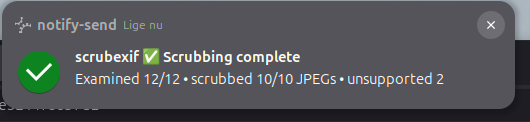
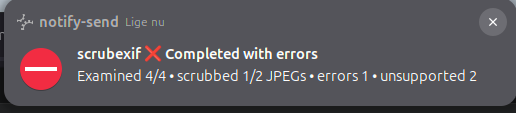

# GNOME Files utilities

Small, useful scripts for [GNOME Files](https://apps.gnome.org/da/Nautilus/) (also known as Nautilus).

## License

All scripts are licensed under the [GNU General Public License v3.0 or later](https://www.gnu.org/licenses/gpl-3.0.html).

## Inspiration

I got some very good inspiration from [Amy Tabb's blog entry on watermarking](https://amytabb.com/til/photography/2021/01/23/image-magick-watermark/) — good stuff :-)

## Requirements

The scripts have different dependencies. Install the ones needed by the scripts you intend to use:

- Docker (for `scrubexif.sh`; the current user needs permission to access the Docker daemon).
- ExifTool (for metadata-related scripts other than containerized `scrubexif.sh`, as applicable).
- ImageMagick.
- jpegoptim.
- Python 3 (for `watermark.py`).
- `findmnt` (util-linux), GNU coreutils (`sha256sum`, `cmp`, `sync`, etc.) and `notify-send` (libnotify-bin) for `scrubexif.sh`.

On Ubuntu, a suitable starting point is:

```bash
sudo apt install \
  docker.io \
  libimage-exiftool-perl \
  imagemagick \
  jpegoptim \
  python3 \
  util-linux \
  coreutils \
  libnotify-bin
```

The scrubexif container already contains its own image-processing tools; ExifTool does not need to be installed on the host *solely* for `scrubexif.sh`.

## Location

Copy the scripts to `~/.local/share/nautilus/scripts` and make them executable (for example, `chmod u+x ~/.local/share/nautilus/scripts/scrubexif.sh`).

## Scripts

| Script | New file | Description |
|---|---|---|
| `30percent.sh` | No | Uses jpegoptim to reduce the size of a JPEG. |
| `reducemeta.sh` | No | Removes most JPEG metadata. |
| `remove-meta-data.sh` | No | Removes JPEG metadata. |
| `rename-2-timestamp` | No | Renames an image using its capture timestamp where available. |
| `scrubexif.sh` | No | **Requires Docker.** Processes selected JPEGs with [scrubexif](https://github.com/per2jensen/scrubexif), with additional container and filesystem safeguards. |
| `watermark.py` | Yes | Improved version 2 of my watermark script, in Python. |
| `watermark.sh` | Yes | Version 1 of my watermark script. |
| `watermark2.sh` | Yes | Version 2 of my watermark script. |

**Caution:** Some scripts change originals; others create new files. Check the individual script before use, and keep backups of irreplaceable files.

## Usage

1. Select one or more files in a directory in GNOME Files.
2. Right-click and open **Scripts** (the label may vary by GNOME version).
3. Choose the utility.

The displayed scripts come from `~/.local/share/nautilus/scripts` and other configured script locations. GNOME Files passes selected paths through `NAUTILUS_SCRIPT_SELECTED_FILE_PATHS`.

## `scrubexif.sh` — containerized JPEG metadata scrubbing

This Nautilus integration requires scrubexif 0.8.0 or newer and uses
`per2jensen/scrubexif:latest` by default. It runs scrubexif in `--clean-inline`
mode: **selected JPEG originals are modified/replaced**. Test with disposable
copies first. Non-JPEG files are reported as unsupported rather than sanitized.

### Input validation

- Refuses to run without a selection, avoiding accidental processing of a whole directory.
- Requires all selected files to be regular, non-symlink files in the same directory.
- Rejects duplicate selections and root execution.
- Nautilus supplies newline-separated paths; filenames containing newlines are unsupported by this wrapper.

### Docker isolation

The container runs with:

- An explicitly selected non-root UID and GID.
- Read-only container root filesystem and `no-new-privileges`.
- All Linux capabilities dropped (`--cap-drop=ALL`).
- Network access disabled (`--network=none`).
- A private, size-limited `/tmp` tmpfs and `--pids-limit=128`.

The selected directory is still mounted read/write in local processing mode. These controls reduce the container's privileges but **do not sandbox individual files from one another**: a compromised image parser could access other files in that mounted directory. A read-only root filesystem does not make the bind-mounted photo directory read-only.

### Local and remote filesystems

The wrapper checks filesystem type using `findmnt`:

- **Local filesystems:** bind-mounts the selected directory directly and processes selected filenames in one container run. scrubexif itself controls inline publication.
- **FUSE, NFS and CIFS/SMB:** copies selected inputs into a fresh local temporary directory, processes those copies in one container run, and only then considers copying changes back. The wrapper checks available local temporary space before starting (requiring more than twice the combined input size).

For remote copy-back, the wrapper:

1. Hashes the originals before processing.
2. Requires either a successful Docker exit with no reported errors, or exit
   status 1 with a valid, internally consistent summary that reports errors.
3. Checks whether originals changed while processing and refuses to overwrite changed files.
4. Stages each changed output next to its original, compares its contents and syncs the staged file.
5. Rechecks original hashes and publishes each changed file using a same-directory rename.

This avoids copying directly over an original, which could otherwise truncate or partially overwrite it. **Replacement is atomic per file, not across a batch.** A late failure can leave some files replaced and others unchanged. Concurrent changes between the final hash check and rename remain possible; external serialization is needed to eliminate that race. Atomicity and durability also depend on the destination filesystem's semantics.

Temporary work files are cleaned during ordinary exit and handled SIGINT/SIGTERM. A crash, `SIGKILL`, power loss, or failed cleanup can leave temporary files, including `.scrubexif-stage.*` beside originals. Inspect such files before removal.

### Results and diagnostics

The wrapper requires a machine-readable `SCRUBEXIF_SUMMARY schema=2` and
validates all required counters and reconciliation identities. Legacy schema-1,
missing, unknown, duplicated, malformed, or inconsistent reporting is treated
as failure; the wrapper never invents fallback values. Exit status 1 with
reported processing errors is treated as a controlled partial result:
successfully changed remote copies are published with the same fingerprint and
atomic-replacement checks as a fully successful run. Abnormal container exits
publish no remote changes. Processing errors always produce an error
notification, even when other JPEGs were scrubbed successfully.

Desktop notifications report the numbers selected, examined and scrubbed, with skipped, errors, duplicates and unsupported counts when applicable. A mixed selection containing JPEGs plus non-JPEG files may show **Scrubbing complete** alongside an unsupported count; this does not mean the unsupported files were sanitized.

The default log is `/tmp/scrubexif.log` (override with `SCRUBEXIF_LOGFILE`). The image can be overridden with `SCRUBEXIF_IMAGE`; `RUN_AS_UID`, `RUN_AS_GID` and `TMPDIR` are also supported. For reproducible testing, consider using a specific versioned image tag rather than `latest`.


#### Example of `success` notification



#### Example of `error` notification




### Verification status (October 2026)

The revised integration has been exercised in GNOME Files against:

| Filesystem/workload | Observation |
|---|---|
| Local filesystem, mixed selection | Successful: 1 JPEG scrubbed, 2 unsupported files. |
| pCloudDrive/FUSE, mixed selection | Successful: 1 JPEG scrubbed, 2 unsupported files. |
| NFS (`/mnt/par2/test`), mixed selection | Successful: 1 JPEG scrubbed, 2 unsupported files. |
| NFS batch, 12 selected files | Successful: 10/10 JPEGs scrubbed, 2 unsupported files; JPEG metadata removal independently checked by the tester. |

These observations support **normal-path compatibility**, not a general guarantee of privacy or crash safety. The following have **not yet been verified end-to-end** on these filesystems: forced copy-back failures, interruptions during publication, concurrent modifications, and crash/restart recovery. Use test copies until the failure paths are adequately evaluated.

### Privacy boundary

scrubexif focuses on JPEG metadata covered by its active sanitization policy. Metadata verification is not equivalent to proving that a photograph contains no identifying information: visible image content, filenames, sidecar files and external records can still disclose information. Refer to the [scrubexif project](https://github.com/per2jensen/scrubexif) for its supported inputs and current guarantees.

## More information

- [GNOME Files application](https://apps.gnome.org/da/Nautilus/)
- [GNOME Files help](https://help.gnome.org/users/gnome-help/stable/files.html)
- [Linux.com article on extending Nautilus scripts (2006)](https://www.linux.com/news/extending-nautilus-scripts-and-extensions/)
